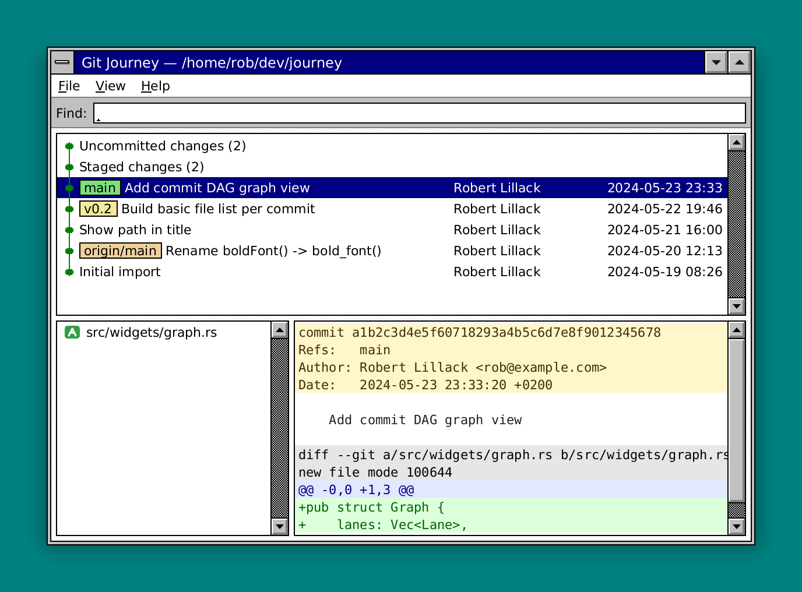
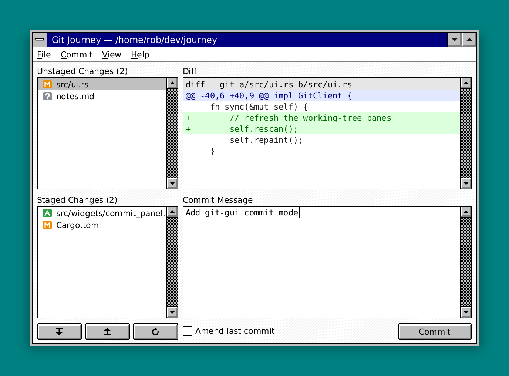

# Git Journey

[](https://github.com/roblillack/gitj/actions/workflows/ci.yml)
[](https://crates.io/crates/gitj)
[](LICENSE)

A gitk-style repository browser and commit helper built on the
[Saudade](https://github.com/roblillack/saudade) toolkit.

```
gitj            # browse the repository containing the current directory
gitj /path/repo # browse the repository at (or above) a given path
gitj -c         # open straight onto the commit (staging) screen
gitj -r         # open the branch-review screen on the checked-out branch
gitj -r feat/x  # open the branch-review screen with feat/x selected
gitj --version  # print the version and exit
gitj --help     # print usage and exit
```

Git Journey has three screens — the gitk-style **browse** (history) screen, the
`git gui`-style **commit** (staging) screen, and the **review** screen, which
shows everything a branch would bring in. Switch between them from the **View**
menu (Ctrl+1 / Ctrl+2 / Ctrl+3), by double-clicking a working-tree entry in the
log, or automatically: committing drops you back to the log.

## Screenshots

Browse screen — gitk-style history with the DAG graph, ref badges and a
`git show`-style detail/diff pane:



Commit screen — `git gui`-style staging with unstaged/staged lists, a per-file
diff and the message editor:



<!--
These images are rendered by [`examples/screenshots.rs`](examples/screenshots.rs),
which drives the real UI against the in-memory `FixtureBackend` through saudade's
offscreen `MockBackend`, then wraps each window in Canoe-style chrome — title
bar, frame and drop shadow — with `render_framed` and captures it at 2× for
crisp hi-DPI output. Regenerate them with `cargo run --example screenshots`.
-->


## Installation

```sh
cargo install gitj
```

On Linux, the build links against Wayland and xkbcommon, so install their
development packages first (`libwayland-dev libxkbcommon-dev pkg-config` on
Debian / Ubuntu). X11 is loaded at runtime and needs nothing extra.

Graphical SVG diffs are built in by default; `cargo install gitj
--no-default-features` leaves them out, and SVG files then get a plain text
diff.

## Features

### Browse

* **Commit history** of the checked-out branch (like plain `gitk`) with a
  colored DAG **graph** column, branch / tag / HEAD **ref badges**, and
  author + date columns.
* **`git show`-style detail**: selecting a commit shows its SHA, refs,
  author, date, message and full diff; selecting a file narrows the diff to
  that file.
* **Diff view** with the usual coloring — green additions, red deletions,
  blue hunk headers, gray file headers.
* **Graphical image diff**: selecting a changed image (PNG, JPEG, GIF, WebP,
  BMP, TIFF, …) shows the two versions visually instead of a "binary files
  differ" line. Compare them side by side (**2-up**), with a **swipe** split, an
  **onion-skin** cross-fade, or a per-pixel **difference** heatmap — switched
  from the button row or the **View** menu (**Switch Mode**, Ctrl+M), with a
  slider driving the swipe / onion position. **Before** / **After Image**
  (Ctrl+Left / Ctrl+Right) show just the old / new side full size, and **Next** /
  **Previous Image** (Ctrl+N / Ctrl+P) step between the image files in the active
  list. **SVG** files are rasterized into the same comparison, each side drawn
  crisply at the size it occupies, with bundled fonts so text renders the same
  on every machine. Works in the browse, commit and review diff panes.
* **Working-tree entries**: when there are local changes, the log leads with
  "Uncommitted changes" / "Staged changes" rows (connected into the graph at
  `HEAD`). Selecting one previews its files and diff; **double-clicking** it
  (or pressing Enter) opens the commit screen.
* **Search / filter** the history live by message, author, ref or SHA.

### Commit

* **Unstaged** and **Staged** file lists (à la `git gui`), each file marked
  with its git status (added, modified, deleted, …). Double-click a file (or
  press Enter) to stage / unstage it, or use the **Stage** / **Unstage**
  buttons. Afterwards the next file in the list is selected, so you can work
  through the changes one by one.
* **Multi-selection**: Ctrl+click (⌘+click on macOS) adds or removes a file,
  Shift+click or Shift+Arrow selects a range, and the Stage / Unstage buttons,
  their shortcuts and Enter then act on every selected file at once.
* The **diff pane** shows the selected file's change — working-tree-vs-index
  for unstaged files, index-vs-`HEAD` for staged ones.
* **Partial staging**: highlight lines in the diff and a floating **Stage** /
  **Unstage** button applies just those lines to the index; clicking a hunk
  header selects the whole hunk.
* **Revert / discard** an unstaged change (`git gui`'s **Revert Changes**,
  **Ctrl+J**): a tracked file is reset to its index copy, while an *untracked*
  file — having nothing to revert to — is offered up for deletion instead.
  Either way a confirm dialog guards the irreversible discard.
* A multi-line **message editor** and a **Commit** button; **Sign Off**
  appends a `Signed-off-by` trailer.
* **Amend last commit**: ticking the box pre-fills the editor with `HEAD`'s
  message *and* re-bases the staging view on `HEAD`'s parent, so the changes
  already in the last commit show up as staged. Unstage any of them to drop
  them from the amended commit; committing then rewrites `HEAD` rather than
  adding a new commit.
* **Rescan** re-reads the working tree. Committing returns to the log view,
  which now shows the new commit.

### Review

* **Branch list**: every local and remote-tracking branch — the checked-out
  one first, and a remote folded into its local's row when both point at the
  same commit — each with its tip commit's summary, author and date.
* **Branch diff**: selecting a branch shows everything it contains — the
  combined diff from its merge base with the repository's default branch (the
  remote's declared default when known, otherwise `main` / `master`) to its
  tip, so commits the default branch gained since the branch point don't show
  up as noise. The file list narrows the diff to a single file.
* `gitj -r` opens straight onto this screen; `gitj -r <branch>` pre-selects
  that branch.

### Throughout

* **Menu bar** (File ▸ Reload / Exit; Commit ▸ the staging actions, on the
  commit screen; View ▸ the screen switches and image-diff actions; Help ▸
  About) with Alt-accelerators, each item's shortcut shown next to it, and a
  modal About / error dialog.
* Keyboard navigation: Tab cycles the panes, arrows/PageUp/Down drive the
  focused list or scroll the diff.
* Mouse-wheel and trackpad scrolling in every list and diff pane, under the
  pointer, without touching the selection.

### Keyboard shortcuts

The commit-screen shortcuts mirror `git gui`. On macOS, use ⌘ instead of
Ctrl.

| Shortcut | Action | Screen |
|----------|--------|--------|
| Ctrl+1 / Ctrl+2 / Ctrl+3 | Switch to Browse History / Commit Changes / Review Branches | all |
| Ctrl+N / Ctrl+P | Jump to the next / previous image file in the list | all |
| Ctrl+M | Switch the image comparison mode | all |
| Ctrl+Left / Ctrl+Right | Show only the before / after image | all |
| Ctrl+Q | Quit | all |
| Ctrl+T | Stage the selected file(s) | commit |
| Ctrl+I | Stage all changes | commit |
| Ctrl+U | Unstage the selected file(s) | commit |
| Ctrl+J | Revert the selected unstaged file (or delete it, if untracked) | commit |
| Ctrl+S | Append a `Signed-off-by` trailer | commit |
| Ctrl+Enter | Commit | commit |
| Ctrl+R | Rescan the working tree | commit |

The commit message editor takes the usual copy / cut / paste / select-all
shortcuts.

## Architecture

The UI never touches `git2` directly — it goes through a small backend
abstraction, which keeps everything testable without a live repository.

| Module | Contents |
|--------|----------|
| `backend` | `RepoBackend` trait + data types (`CommitInfo`, `BranchInfo`, `FileChange`, `Diff`/`DiffLine`, `BlobPair`, `RefLabel`, `WorkingStatus`). Browse reads history/diffs; review mode lists branches and diffs each against its merge base with the default branch (`branches`, `branch_files`, `branch_diff`, `branch_file_diff`); commit mode adds working-tree status, per-file diffs, `stage`/`unstage`, `revert`/`delete_untracked`, `commit` (with amend), and partial staging via `apply_to_index` fed by the `patch` module's line-range patches; image diffs read the two sides' raw blobs (`commit_file_blobs`/`working_file_blobs`/`branch_file_blobs`). Implementations: `Git2Backend` (live, libgit2) and `FixtureBackend` (deterministic, in-memory, with a simulated working tree). |
| `imagediff` | Decodes image blobs (via the `image` crate) and composes the two sides into a comparison canvas for the 2-up / swipe / onion-skin / difference modes — the toolkit-independent half of the graphical diff. |
| `svg` | Sniffs SVG blobs and rasterizes them (via `resvg`, with bundled Public Sans and IBM Plex Mono fonts) so they flow through the same comparison as raster images. Gated behind the default `svg` feature. |
| `widgets` | git-specific widgets — `CommitList` (graph + badges + columns), `DiffView` (colored diff), `ImageDiffView` (graphical image diff) wrapped by `DiffPane` (shows whichever the file calls for), `SearchBar`, `Heading`, `graph` (DAG lane assignment); `Shell`, a generic flat-focus container, plus a `layout` module giving the browse, commit and review screens their rectangles; generic `Shared<W>` adapter. |
| `ui` | `GitClient`, the top-level widget. It owns all three screens (a `Shell` each), switches between them, and — since saudade widgets are callback-free — polls selections and a small command queue after each event to rebuild dependent panes. |

## Testing

* **Pixel snapshots** (`tests/snapshots.rs`) render the real UI through
  saudade's offscreen `MockBackend` at 1.0× against the
  in-memory `FixtureBackend` and bundled DejaVu fonts, comparing PNG bytes
  with `insta`. Regenerate with `INSTA_UPDATE=always cargo test --test
  snapshots`, then review with `cargo insta review`.
* **`tests/git2_backend.rs`** builds a throwaway repository with fixed
  signatures/timestamps and reads it back through `Git2Backend`, so the live
  backend is covered deterministically.
* **`tests/image_blobs.rs`** commits and edits a PNG in a throwaway repository
  and asserts `Git2Backend` returns the exact blob bytes for each side of a
  commit and working-tree image change.
* **`tests/commit_backend.rs`** exercises commit mode end to end: it stages,
  unstages, reverts, commits and amends in a throwaway repository (and against
  the fixture), asserting the working-tree status at each step.
* **`tests/partial_stage.rs`** builds a patch covering part of a file's
  changes, applies it to the index of a throwaway repository through
  `Git2Backend`, and confirms only the selected lines moved.
* **`tests/shortcuts.rs`** drives a real `GitClient` through synthetic key
  events (Ctrl+T / I / U / J / Enter / 1 / 2 / Q, plus Ctrl+click
  multi-selection) and asserts the resulting working-tree and commit state —
  the runtime path minus the windowing. It also checks that the Mac scheme
  binds the same actions to ⌘.
* **Unit tests** cover the graph lane algorithm, date formatting, argument
  parsing, partial-patch building, image composition, SVG rasterization and
  wheel scrolling.

```
cargo test          # everything
cargo build         # the binary
```
